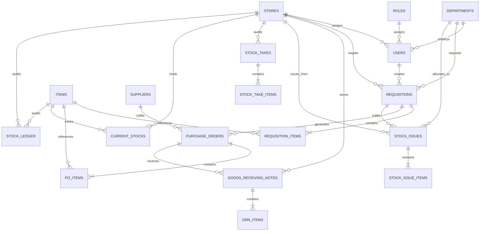

# Hotel Purchasing & Inventory System

A standalone, back-office **Hotel Purchasing & Warehouse Inventory Management System** built with **Laravel 13 REST API** and **Nuxt 3 / Vue 3 + Tailwind CSS**.

> **Note on POS & Recipes**: This system is exclusively focused on back-office procurement, warehouse stock movements, and departmental requisitions. It contains **zero POS tables, zero recipe-based deductions, and no point-of-sale integrations**.

---

## 1. System Architecture & Stack

- **Backend**: Laravel 13 (`PHP 8.4.26`, `laravel/sanctum v4.3.3`) in `backend/`
- **Database**:
  - Local Development & Testing: SQLite (`database/database.sqlite` and `:memory:`)
  - Production: MySQL 8.x (`DB_CONNECTION=mysql`, `DB_DATABASE=hotel_purchasing_inventory`)
- **Frontend**: Nuxt 3 (`v3.21.11`, `Nitro v2.13.4`, `Vite v7.3.6`, `Vue 3.5.43`) with Tailwind CSS in `frontend/`
- **Language**: JavaScript (ES Modules, no TypeScript), Vue 3 Composition API (`<script setup>`)

---

## 2. Core Modules & Implementation Status

| Module | Scope / Features | Status |
|---|---|:---:|
| **Part 1: Schema & Models** | 14 relational tables, Eloquent models, casts, foreign keys, idempotent seeders | ✅ Completed |
| **Part 2: Master Data** | Suppliers, Items/Catalog, Stores, Departments (CRUD, search, filters, deactivation) | ✅ Completed |
| **Part 3: Requisitions** | Store Requisitions (SR), Purchase Requisitions (PR), HOD/GM approval, Segregation of Duties | ✅ Completed |
| **Part 4: Procurement & PO** | PO generation from GM-approved PRs, supplier selection, pricing, sending | ✅ Completed |
| **Part 5: GRN & Stock IN** | Goods Receiving Notes against POs, partial/full delivery, atomic Stock IN, over-receipt rejection | ✅ Completed |
| **Part 6: Bulk Stock Issues** | Stock Issue against approved SRs, partial issue tracking, atomic Stock OUT, cost attribution | ✅ Completed |
| **Part 7: Inventory & Audit** | Current Stock reports, par-level alerts, Stock Ledger audit trail, stock taking & ADJ posting | ✅ Completed |
| **Part 8: Frontend UX** | Responsive layouts, navigation, global auth guard, cross-module shortcuts, toasts | ✅ Completed |
| **Part 9: RBAC & Security** | Role-Action matrix, IDOR protection, department/store scoping, parameter tampering defense | ✅ Completed |
| **Part 10: E2E & Release** | Multi-step E2E workflows, mathematical reconciliation, release verification | ✅ Completed |

---

## 3. Database Schema & Relational Design



### Key Principles:
1. **Mathematical Reconciliation**:
   $$\text{Current Stock Quantity} = \sum_{\text{stock\_ledger}} \text{quantity (signed: } + \text{IN}, - \text{OUT}, \pm \text{ADJ)}$$
2. **Double-Posting Protection**:
   `stock_ledger` enforces a composite unique constraint on `(reference_type, reference_id, item_id, store_id)` ensuring retry or race conditions cannot duplicate stock movements.
3. **Audit Immutability**:
   `stock_ledger` records cannot be updated or deleted via HTTP endpoints (`404`/`405`). Only atomic database transactions executed by authorized services can append movements.

---

## 4. Role-Action Matrix

| Role | Requisitions | PO | GRN (Stock IN) | Stock Issue (OUT) | Stock Take | Stock Adjustment |
|---|:---:|:---:|:---:|:---:|:---:|:---:|
| `admin` | Full | Full | Approve / Post | Draft / Post | Count | Approve / Post |
| `gm` | GM Approve PR | Read | Read | Read | Read | Read |
| `hod` | Submit & HOD Approve (Own Dept) | Read | Read | Read | Read | Read |
| `procurement_officer` | Submit PR | Create & Send | Read | Read | Read | Read |
| `store_manager` | Read | Read | Approve / Post | Draft / Post | Count | Approve / Post |
| `store_keeper` | Read | Read | Draft Pending | Draft / Post | Count | Read |
| `department_staff` | Submit (Own Dept) | Read | Read | Read | Read | Read |

---

## 5. Seeded Demo Accounts

All seeded accounts use password: `password123`

| Email | Role | Department / Store Scope |
|---|---|---|
| `admin@hotel.local` | `admin` | Executive / Administrative |
| `gm@hotel.local` | `gm` | General Management |
| `hod.hk@hotel.local` | `hod` | Housekeeping (`DEPT-HK`) |
| `staff.hk@hotel.local` | `department_staff` | Housekeeping (`DEPT-HK`) |
| `hod.kit@hotel.local` | `hod` | Kitchen & Culinary (`DEPT-KIT`) |
| `staff.kit@hotel.local` | `department_staff` | Kitchen & Culinary (`DEPT-KIT`) |
| `procurement@hotel.local` | `procurement_officer` | Purchasing & Procurement |
| `store.manager@hotel.local` | `store_manager` | Main Central Store (`STR-MAIN`) |
| `store.keeper@hotel.local` | `store_keeper` | Main Central Store (`STR-MAIN`) |

---

## 6. Setup, Execution & Testing Commands

### Backend (`/backend`)
```bash
# Install PHP dependencies (already installed)
composer install

# Run database migrations and seeders
php artisan migrate --force
php artisan db:seed --force

# Code style checking / auto-formatting
./vendor/bin/pint --test
./vendor/bin/pint

# Run full automated test suite (52 tests, 602 assertions)
./vendor/bin/phpunit --testdox
```

### Frontend (`/frontend`)
```bash
# Install Node dependencies (already installed)
npm install

# Start development server
npm run dev

# Run production build check
npm run build
```

---

## 7. Automated Test Suite Verification

```text
OK (52 tests, 602 assertions)

Example (Tests\Feature\Example)
 ✔ The application returns a successful response

Example (Tests\Unit\Example)
 ✔ That true is true

Part1Schema And Model (Tests\Feature\Part1SchemaAndModel)
 ✔ All required tables exist and pos recipe tables do not exist
 ✔ Seeder runs idempotently without duplicating unique records
 ✔ Unique constraints prevent duplicate sku order numbers and current stock pairs
 ✔ Current stocks enforces unique item and store pair
 ✔ Eloquent relationships and decimal casts across purchasing and inventory models
 ✔ Non cascading foreign keys prevent deleting referenced master or transaction records
 ✔ Unique document numbers and idempotent stock ledger constraint

Part2Master Data (Tests\Feature\Part2MasterData)
 ✔ Authentication login me and logout endpoints
 ✔ Unauthenticated and unauthorized users cannot modify master data
 ✔ Supplier crud search filter pagination and deactivation
 ✔ Item crud validation uom par level filter and deactivation
 ✔ Store and department crud and deactivation
 ✔ Referenced records cannot be hard deleted while unreferenced records can
 ✔ Sorting accepts only allow listed columns and rejects arbitrary queries

Part3Requisition Workflow (Tests\Feature\Part3RequisitionWorkflow)
 ✔ Department user can submit valid sr and invalid payloads are rejected
 ✔ Sr hod approval respects department scope and does not deduct stock
 ✔ Pr workflow follows pending to hod approved to gm approved and blocks stage skipping
 ✔ Segregation of duties prevents users from approving their own requisitions
 ✔ Rejection workflow records actor timestamp and reason and locks further actions

Part4Purchase Order (Tests\Feature\Part4PurchaseOrder)
 ✔ Only fully gm approved pr can generate po and duplicate pos are blocked
 ✔ Supplier item quantity and price validation and server total calculation
 ✔ Po status transitions edit restrictions and zero stock impact
 ✔ Unauthorized users cannot create update or send purchase orders

Part5Grn Stock In (Tests\Feature\Part5GrnStockIn)
 ✔ Submitting pending grn does not modify stock and approving partial then final grn updates stock and po status
 ✔ Over receipt invalid quantities and double posting are rejected
 ✔ Unauthorized users and non store managers cannot approve grn
 ✔ Simulated database failure during grn approval rolls back all changes atomically

Part6Stock Issue Out (Tests\Feature\Part6StockIssueOut)
 ✔ Draft issue does not deduct stock and posting partial then final issue updates stock ledger and sr status
 ✔ Non approved sr insufficient stock excess sr quantity and double posting are rejected
 ✔ Unauthorized users cannot create or post issues and forged actor or stock is ignored
 ✔ Simulated database failure during issue posting rolls back all changes atomically

Part7Inventory Ledger Adjustment (Tests\Feature\Part7InventoryLedgerAdjustment)
 ✔ Current stock queries and low par level flags
 ✔ Stock ledger filters and pagination
 ✔ Physical stock take creation snapshot and variance calculation
 ✔ Stock adjustment approval applies positive and negative deltas atomically
 ✔ Stale count snapshot is detected and rejected
 ✔ Unauthorized users cannot post adjustments and stock ledger is immutable
 ✔ Simulated failure during adjustment rolls back all changes atomically
 ✔ Stock reconciliation verifies ledger sum matches current stocks

Part9Rbac Security (Tests\Feature\Part9RbacSecurity)
 ✔ Unauthenticated requests to all protected endpoints are rejected
 ✔ Hod department scoping and cross department idor rejection
 ✔ Segregation of duties prevents creator from self approving
 ✔ Gm stage enforcement and sr approval rejection
 ✔ Store manager role enforcement for grn approval and stock adjustments
 ✔ Parameter tampering forged actor and fake stock balances are ignored
 ✔ Login rate limiting protects against brute force attacks

Part10End To End Workflow (Tests\Feature\Part10EndToEndWorkflow)
 ✔ Complete end to end store requisition to stock issue and stock out workflow
 ✔ Complete end to end purchase requisition to po to partial and final grn workflow
 ✔ Complete end to end stock take to adjustment and mathematical reconciliation
 ✔ No pos or recipe deduction leakage across entire system
```
